<div align="center">


**La plateforme de casting assistée par intelligence artificielle, conçue à Tunis.**<br>
Une agence décrit un rôle en une phrase ; AI Casting trouve, classe et explique les meilleurs profils, puis organise les auditions.

[](https://openjdk.org/)
[](https://spring.io/projects/spring-boot)
[](https://angular.dev/)
[](https://github.com/pgvector/pgvector)
[](https://ollama.com/)
<br>


[**Visite**](#-la-visite-en-11-secondes) · [**Fonctionnalités**](#-fonctionnalités) · [**Comment ça marche**](#-comment-ça-marche) · [**Démarrer**](#-démarrer) · [**Chiffres**](#-en-chiffres) · [**Avancement**](#-avancement)

</div>

---

## 🎬 La visite en 11 secondes

<div align="center">
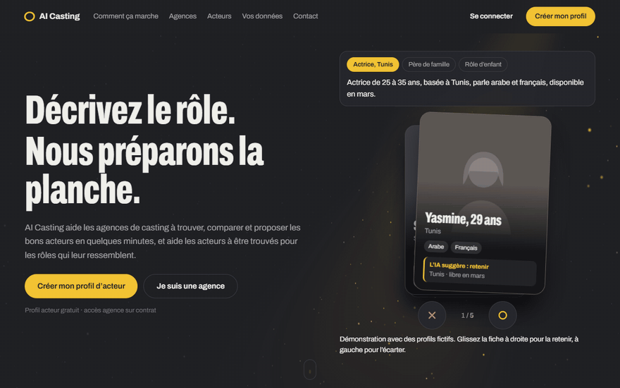
<br><sub>Vitrine → recherche IA → filtres du vivier → shortlist d’un rôle → agenda. Les photos des profils de démonstration sont floutées.</sub>
</div>

<details>
<summary><b>🎞️ L’écran d’accueil animé</b> · cercle au crayon, planche contact, clap, ouverture à l’iris</summary>
<br>
<div align="center"></div>
<sub>À chaque arrivée sur la page d’accueil ; passable d’un clic ou d’une touche ; désactivé si le système demande de réduire les animations.</sub>
</details>

## 💡 Pour qui ?

| 🎯 Agence de casting | 🎭 Acteur ou actrice | 🎥 Réalisateur |
|---|---|---|
| Décrit le rôle en français courant, compare les profils proposés par l’IA, monte ses shortlists, convoque aux auditions. | Crée son profil gratuitement, choisit qui le voit, répond aux propositions, retrouve ses auditions dans son agenda. | Reçoit un lien sécurisé, parcourt les candidats et vote, sans créer de compte. |

---

## ✨ Fonctionnalités

> Cliquez sur une ligne pour la déplier.

<details open>
<summary><b>🔎 Recherche IA en langage naturel</b> · décrire le rôle, l’IA classe et explique</summary>
<br>

« *Actrice entre 20 et 35 ans qui parle anglais et sait danser* » : la demande est comprise, les profils sont classés en moins de 0,2 s, puis l’IA locale rédige pour chaque proposition pourquoi elle convient. On retient d’un glissement à droite, on écarte à gauche ; chaque décision affine les recherches suivantes.

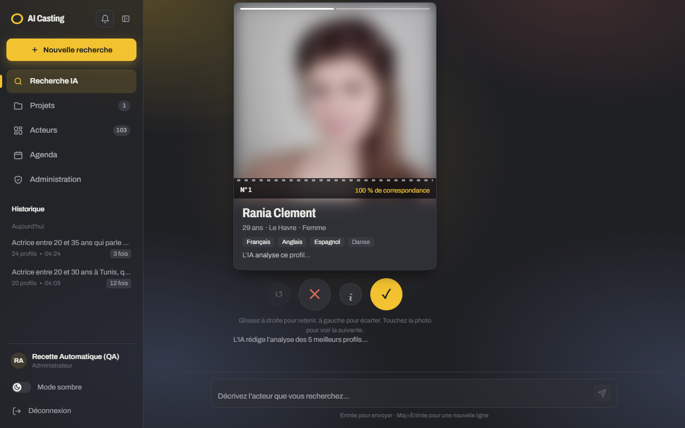
</details>

<details>
<summary><b>🗂️ Vivier à grande échelle</b> · filtres combinés, tenue à 100 000 fiches</summary>
<br>

Genre, âge, ville, taille, langues et compétences, combinables ; suggestions tirées du vivier ; pagination côté serveur. Six filtres combinés répondent en **54 ms sur 100 102 fiches**.

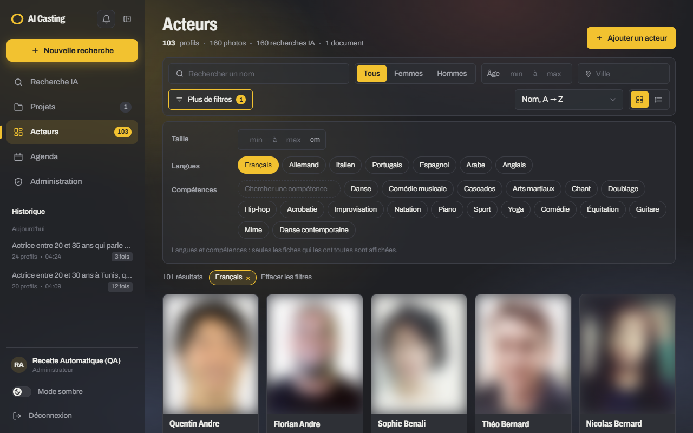
</details>

<details>
<summary><b>📋 Projets, rôles et shortlists</b> · du besoin au choix final</summary>
<br>

Un projet contient des rôles ; chaque rôle a sa shortlist en colonnes (présélectionnés, audition, rappel, choisi, refusés), avec notes, disponibilités et alertes de conflit avec le tournage. Planche PDF et envoi au réalisateur en un clic.

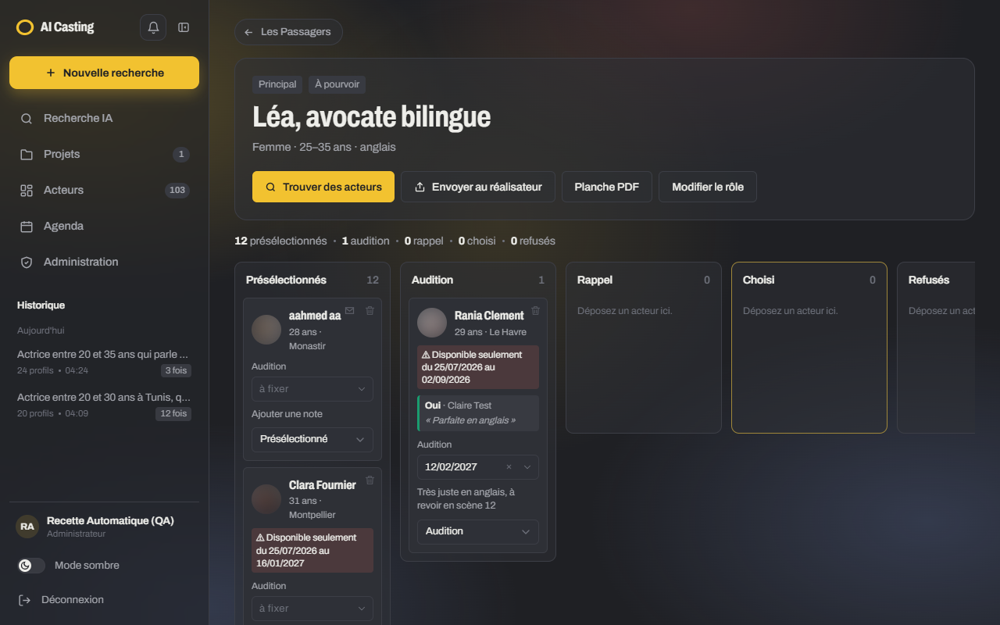
</details>

<details>
<summary><b>📅 Convocations et agenda des auditions</b> · date, heure, lieu, rappel la veille</summary>
<br>

L’agent convoque ; l’acteur accepte en un clic ; l’audition entre dans l’agenda des deux. Rappel dans la cloche la veille à 18 h, lieu ouvrable sur une carte, export vers Google Agenda, Outlook ou le téléphone (`.ics`).

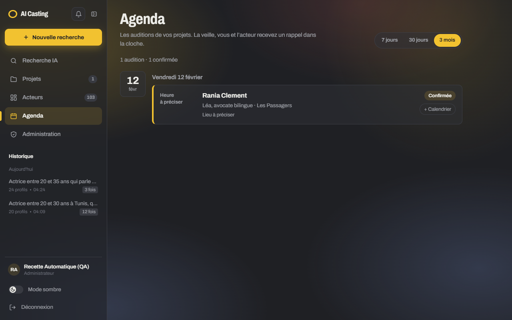
</details>

<details>
<summary><b>🏢 Plusieurs agences, un vivier partagé</b> · contrats, équipes, visibilité</summary>
<br>

- Chaque agence a ses comptes, son contrat (dates, rappel de renouvellement) et ses fiches.
- Un acteur apporté par une agence reste chez elle, sauf s’il choisit de rejoindre le vivier commun.
- Coordonnées masquées pour les autres agences : chaque consultation est demandée, tracée et visible de l’acteur.
- Invitation d’un acteur par lien à usage unique ; import de fichiers CSV et Excel.
</details>

<details>
<summary><b>🔐 Sécurité et vie privée dès la conception</b> · loi 2004-63 et RGPD</summary>
<br>

- [x] Jetons JWT avec renouvellement, limitation des essais de connexion, mots de passe faibles refusés
- [x] Photos et documents servis uniquement par des **liens signés** (HMAC, environ 1 h)
- [x] Accord daté et versionné aux conditions et à la politique de confidentialité
- [x] L’acteur télécharge ses données (ZIP) ou supprime son compte lui-même
- [x] Purge automatique chaque nuit des données arrivées en fin de durée de conservation
- [x] Journal d’audit de l’administration, e-mails masqués
- [x] IA exécutée sur nos serveurs : **aucune fiche envoyée à un service d’IA extérieur**

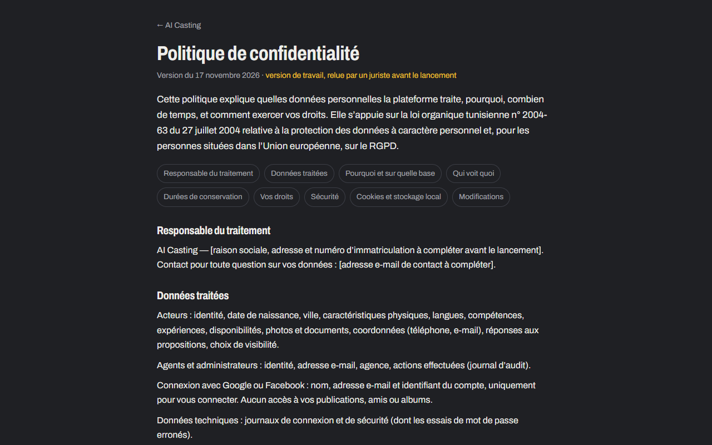
</details>

<details>
<summary><b>📱 Mobile d’abord</b> · tout fonctionne au téléphone</summary>
<br>
<p align="center">
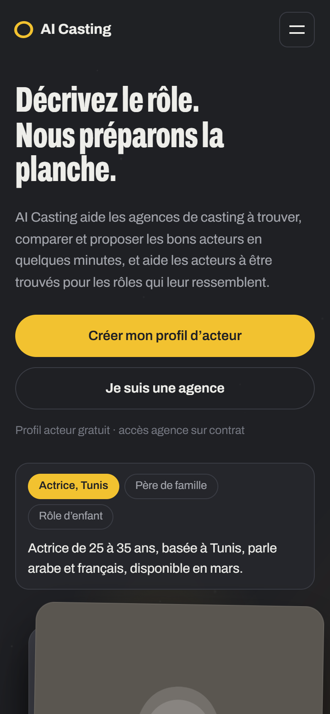
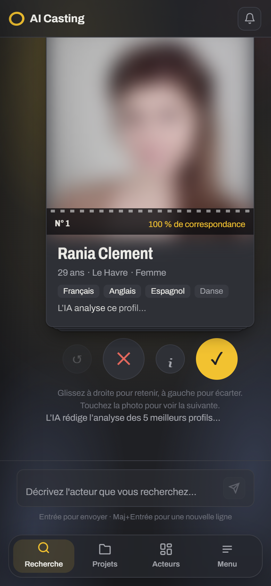
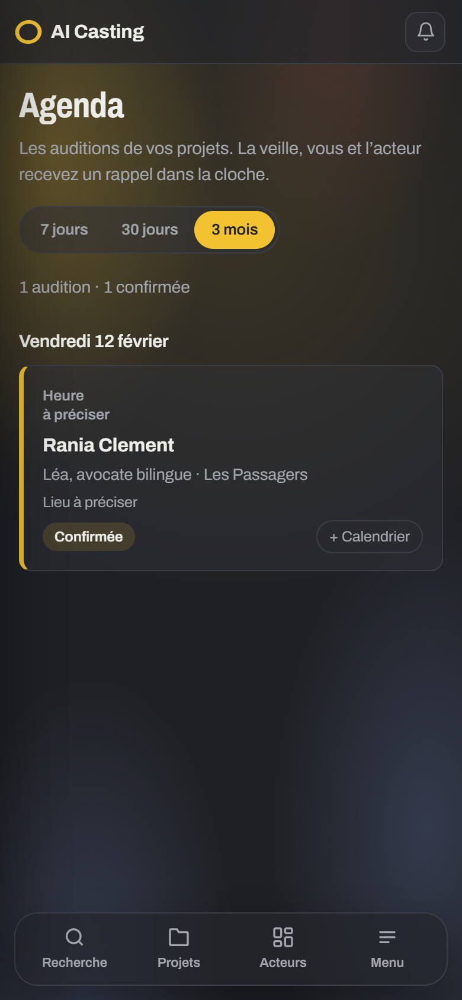
</p>
</details>

---

## 🧭 Comment ça marche

### Le parcours d’un casting

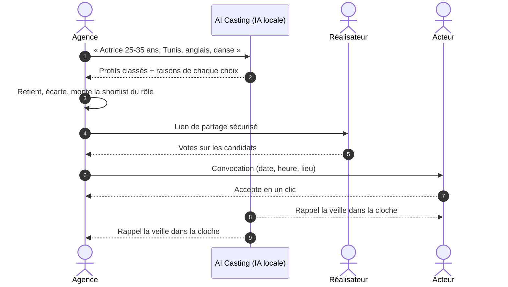

### La recherche IA, étape par étape

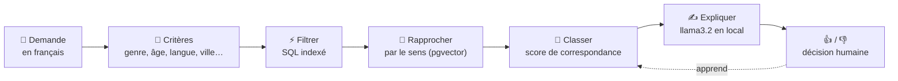

### Architecture

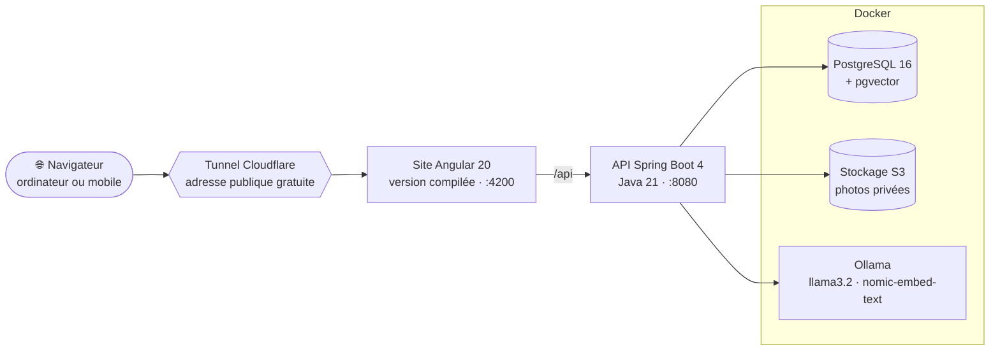

<details>
<summary><b>Technologies et rôle de chaque couche</b></summary>
<br>

| Couche | Technologie | Rôle |
|---|---|---|
| Interface | Angular 20, composants autonomes, signals, GSAP, Three.js, MapLibre | Écrans, animations de la vitrine, carte |
| API | Spring Boot 4, Spring Security 7 (JWT), JPA, Flyway | Règles métier, sécurité, accès aux données |
| Base | PostgreSQL 16 + pgvector, index trigrammes | Données, recherche par le sens, filtres rapides |
| Fichiers | Stockage compatible S3, bucket privé | Photos et documents, servis par liens signés |
| IA | Ollama en local, Spring AI | Comprendre, rapprocher, expliquer |
| Mise en ligne | `scripts/serveur-demo.js` + tunnel Cloudflare gratuit | Démonstration publique depuis un PC |
| Tests | JUnit 5, Testcontainers, Playwright | Serveur, base réelle, navigateur réel |
</details>

---

## 📊 En chiffres

Mesuré sur le code et sur le poste de développement le **18 novembre 2026**.

| ⚙️ Code | | 🧪 Qualité | | ⚡ Performance (100 102 fiches) | |
|---|---|---|---|---|---|
| Lignes Java | **10 146** | Tests serveur | **70 / 70** | Six filtres combinés | **54 ms** |
| Lignes de tests Java | **1 908** | Vérifications navigateur | **104 / 104** | Première page | **< 15 ms** |
| Lignes TypeScript | **9 365** | Vérifications de la salle de pilotage | **25 / 25** | Page 2 000 | **30 ms** |
| Lignes HTML + SCSS | **5 469** | Tâches du plan faites | **105 / 130** | Recherche par nom | **10 ms** |
| Points d’API REST | **113** | Commits sur la branche | **39** | Chargement public d’un écran | **1 à 4 s** |
| Tables / migrations | **29 / 30** | Coût des logiciels | **0 €** | | |

<details>
<summary><b>📈 Temps de réponse selon le volume de données (mesuré puis extrapolé)</b></summary>
<br>

Mesures à 102, 1 102, 10 102 et 100 102 acteurs, puis modèle par étape et extrapolation avec marge d’incertitude. Méthode complète : [`docs/performance.md`](docs/performance.md).

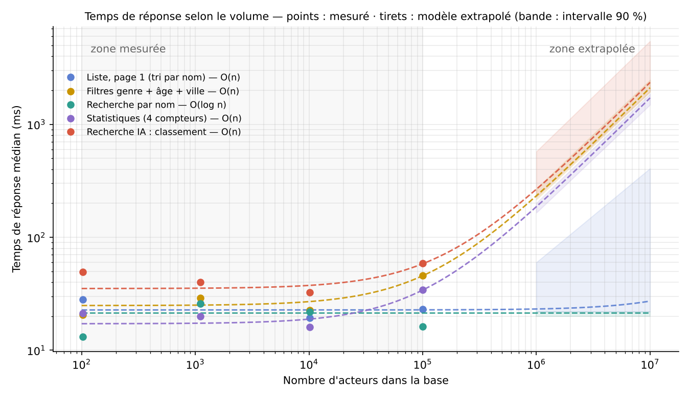
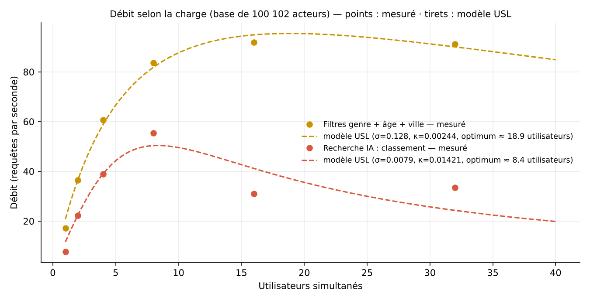
</details>

---

## 🚀 Démarrer

### En une commande (Windows)

```powershell
# Docker Desktop ouvert, puis :
powershell -ExecutionPolicy Bypass -File scripts\lancer-demo.ps1
```

Le script démarre la base, le stockage et l’IA, lance l’API, compile le site, le sert sur `http://localhost:4200` et affiche une **adresse publique** `https://….trycloudflare.com` à partager (elle change à chaque lancement ; le PC doit rester allumé).

<details>
<summary><b>Pas à pas (développement)</b></summary>
<br>

| Outil (gratuit) | Version |
|---|---|
| Docker Desktop | récent |
| JDK | 21 (Java 17 ne suffit pas) |
| Node.js / npm | 22 / 10 |

```bash
# 1. Base, stockage et IA
cd infra && docker compose up -d
docker exec casting-ollama ollama pull llama3.2
docker exec casting-ollama ollama pull nomic-embed-text

# 2. API (Windows) — utilise le JDK 21
cd ../backend/castingai && ./run-backend.ps1

# 3. Site, rechargement automatique
cd ../../frontend/ai-casting-frontend && npm install && npx ng serve   # http://localhost:4200
```

| Adresse | Service |
|---|---|
| http://localhost:4200 | Application |
| http://localhost:8080/swagger-ui.html | Documentation interactive de l’API |

En profil `dev`, un administrateur et 102 acteurs fictifs sont créés au premier lancement : changez son mot de passe dès la première connexion. En profil `prod`, le serveur refuse de démarrer si un secret manque ou garde une valeur de développement.
</details>

<details>
<summary><b>Lancer les tests</b></summary>
<br>

```bash
# Serveur : 70 tests sur une vraie base PostgreSQL (Testcontainers)
cd backend/castingai && ./mvnw test

# Site : compilation de production
cd frontend/ai-casting-frontend && npx ng build

# Navigateur : 104 vérifications, ordinateur et mobile (Playwright + Edge)
node pilotage/tests/test-plateforme.js
```
</details>

---

## 📈 Avancement

| Phase | | Avancement |
|---|---|---|
| 0 · Stabiliser | `███████████████████░` | **92 %** |
| 1 · MVP métier : projets, rôles, shortlists, agences | `██████████████████░░` | **88 %** |
| 2 · IA différenciante | `██████████████░░░░░░` | **70 %** |
| 3 · Lancer : vie privée, mise en ligne, agences pilotes | `█████░░░░░░░░░░░░░░░` | **26 %** |

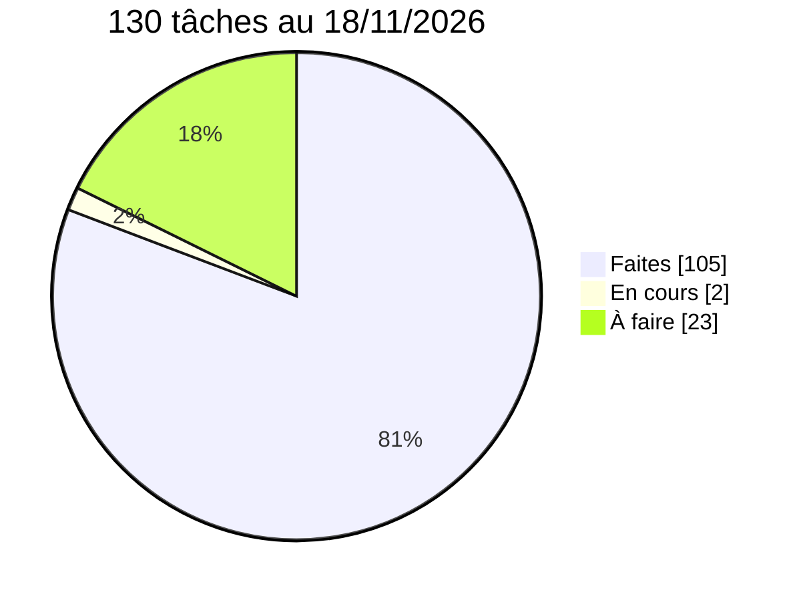

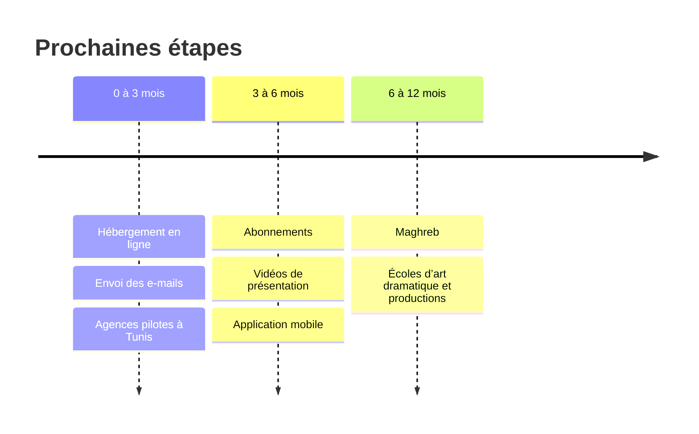

<details>
<summary><b>🏗️ Comment le projet est piloté</b></summary>
<br>

Le développement est organisé comme une entreprise de 31 personnes, **Prisme Ingénierie** (équipe simulée par l’IA) : direction, produit, backend, frontend, IA, QA, DevOps, juridique, finance, RH. Chaque demande du client suit le même cycle, et tout est tracé dans [`pilotage/`](pilotage/) : tâches, décisions, journal quotidien et salle de pilotage en temps réel.

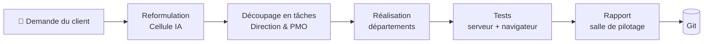
</details>

<details>
<summary><b>🗂️ Structure du dépôt</b></summary>
<br>

```text
ai-casting-platform/
├── backend/castingai/        API Spring Boot (Java 21), migrations Flyway, tests
├── frontend/ai-casting-frontend/   Application Angular 20
├── infra/                    Docker Compose (PostgreSQL + pgvector, stockage, Ollama), mesures de performance
├── scripts/                  lancer-demo.ps1, serveur-demo.js, tunnel.ps1
├── pilotage/                 Plan, journal, salle de pilotage, recettes Playwright
└── docs/                     Captures, bannière, performance, user stories
```
</details>

---

<div align="center">

**AI Casting** · Tunis · [ahmedla9lou9@gmail.com](mailto:ahmedla9lou9@gmail.com)

<sub>Les profils visibles dans les captures sont des données de démonstration fictives.</sub>

</div>
