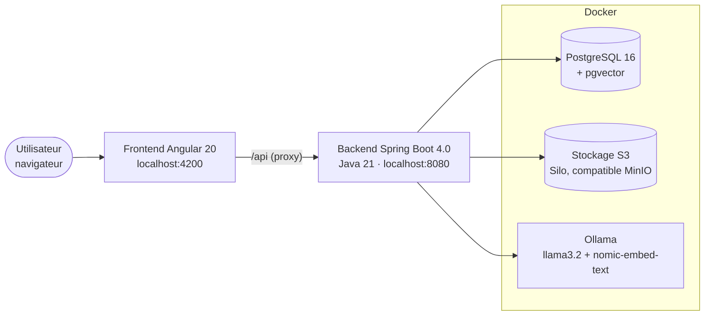
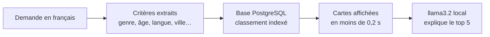
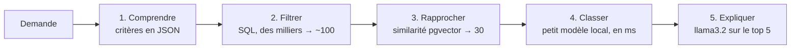
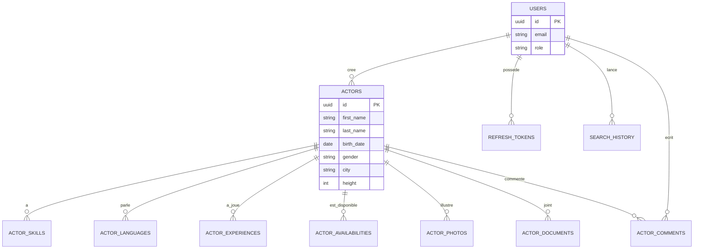
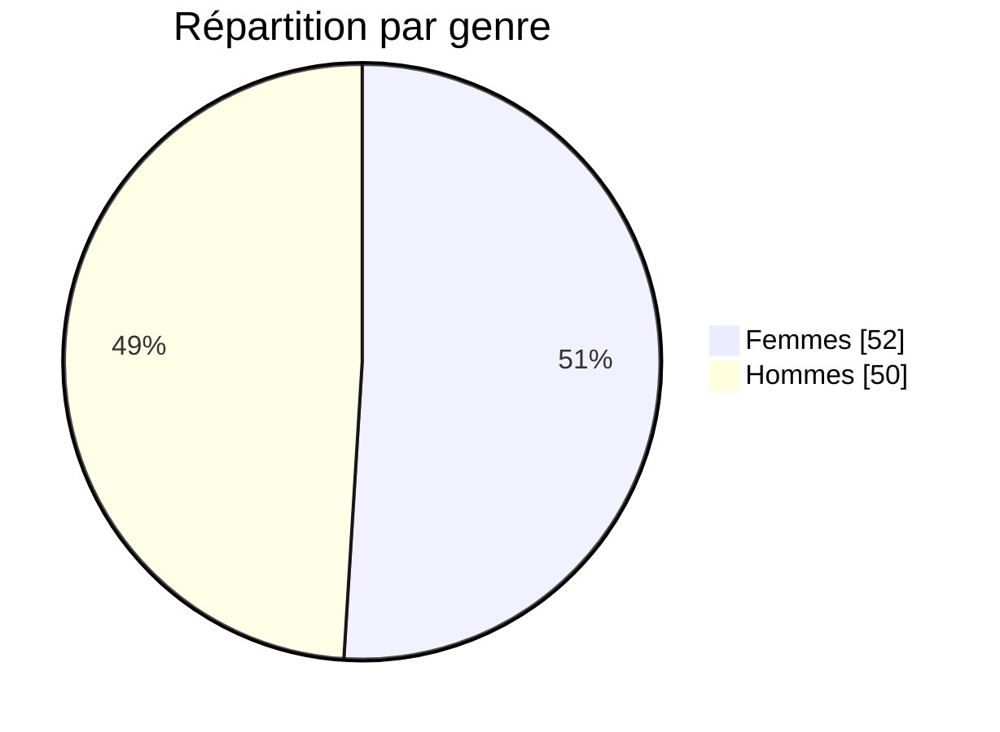
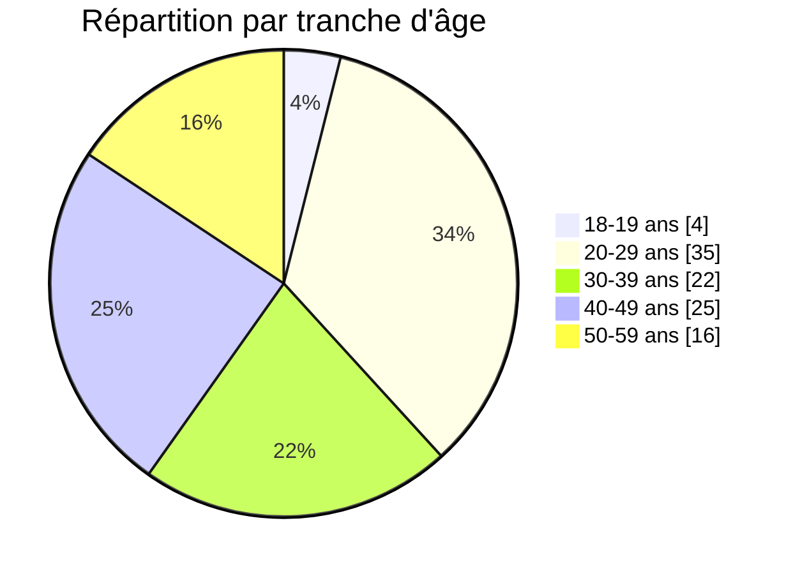
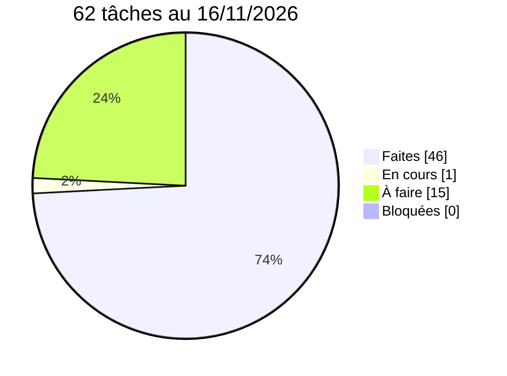
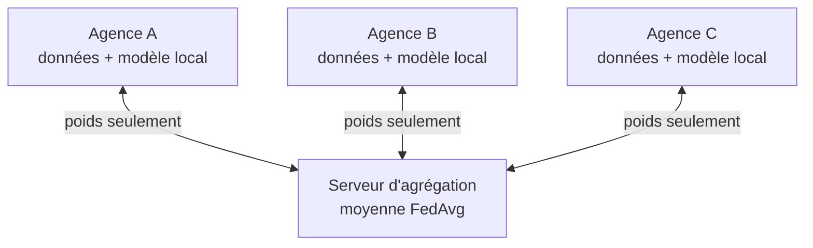
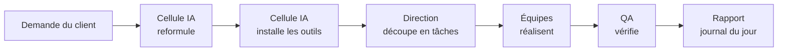

# AI Casting Platform

> Trouvez l'acteur idéal en une phrase.
> Une plateforme de casting qui comprend les demandes en langage naturel (« une femme de 25 à 35 ans qui parle anglais et danse ») et propose les meilleurs profils avec un score et une justification.

     

| | |
|---|---|
| **État** | MVP en construction · avancement estimé **71 %** · phase 0 (stabilisation) à **75 %** |
| **Dernière mise à jour** | 16 novembre 2026 (jour J3 du projet) |
| **Démarrage du projet** | 15 novembre 2026 |
| **Coût des outils** | **0 €** : uniquement des logiciels gratuits et open source, exécutés en local |

---

## Sommaire

1. [Chiffres clés](#1-chiffres-clés)
2. [Fonctionnalités](#2-fonctionnalités)
3. [Architecture](#3-architecture)
4. [La recherche par intelligence artificielle](#4-la-recherche-par-intelligence-artificielle)
5. [Modèle de données](#5-modèle-de-données)
6. [API REST](#6-api-rest)
7. [Statistiques des données de démonstration](#7-statistiques-des-données-de-démonstration)
8. [Avancement du projet](#8-avancement-du-projet)
9. [Qualité et tests](#9-qualité-et-tests)
10. [Installation et lancement](#10-installation-et-lancement)
11. [Configuration](#11-configuration)
12. [Feuille de route](#12-feuille-de-route)
13. [Vision : IA fédérée](#13-vision--ia-fédérée)
14. [Organisation du projet](#14-organisation-du-projet)
15. [Limites connues](#15-limites-connues)

---

## 1. Chiffres clés

Mesurés sur le code, la base de données et le PC de développement le 16 novembre 2026.

| Code | | Données (démo) | | Projet | |
|---|---|---|---|---|---|
| Lignes Java | **4 206** (+145 de tests) | Acteurs | **102** | Tâches réalisées | **46 / 62** |
| Lignes TypeScript | **1 907** | Photos | **159** | Tâches bloquées | **0** |
| Lignes HTML + SCSS | **3 485** | Compétences | **244** | Bugs corrigés | **15** (dont 6 trouvés en test) |
| Points d'API REST | **45** | Langues | **198** | Prompts client traités | **11** |
| Entités / tables | **18** | Expériences | **287** | Tests automatiques réussis | **20 / 20** |
| Migrations de base | **11** | Recherches IA | **54** | Décisions de casting enregistrées | **13** |
| Composants Angular | **15** | Utilisateurs | **1** | Coût logiciel | **0 €** |

---

## 2. Fonctionnalités

| Fonctionnalité | Ce qu'elle permet | État |
|---|---|---|
| **Authentification** | Inscription, connexion, jetons JWT avec renouvellement automatique, déconnexion. API fermée aux visiteurs non connectés (erreur 401). | Opérationnel |
| **Recherche IA en langage naturel** | On décrit le rôle en une phrase ; la base classe les profils en moins de 0,2 s, puis l'IA locale explique les 5 premiers (≈ 7 s sur carte graphique). Historique des recherches. | Opérationnel |
| **Cartes à glisser** | Les propositions s'affichent en cartes avec photos 1, 2, 3 : glisser à droite pour retenir, à gauche pour écarter, flèches du clavier, annulation, résumé des profils retenus. Chaque décision est enregistrée (future IA fédérée). | Opérationnel |
| **Identité visuelle** | Thème « table lumineuse » : graphite et jaune crayon gras, police Archivo, logo en boucle au crayon ; mode clair et sombre. | Opérationnel |
| **Tableau de bord** | Statistiques (acteurs, photos, recherches, documents), liste paginée, filtres genre / âge / ville, recherche par nom, tri par colonne dont l'âge. | Opérationnel |
| **Fiches acteurs** | Création et modification : identité, physique, contact, bio, compétences, langues, expériences, disponibilités. | Opérationnel |
| **Fiche détaillée** | Onglets informations, galerie, expériences, commentaires, documents ; âge calculé, photo principale. | Opérationnel |
| **Galerie photos** | Envoi multiple, compression automatique (1 200 px) et miniature (300 px), photo principale. | Opérationnel |
| **Documents** | CV, contrats et autres fichiers attachés à un acteur. | Partiel |
| **Commentaires internes** | Notes de l'équipe sur un acteur, avec auteur et date. | Opérationnel |
| **Thème clair / sombre** | Choix mémorisé dans le navigateur. | Opérationnel |
| **Projets** | Créer, modifier, archiver ou terminer un projet (film, série, publicité…), avec onglets En cours / Terminés / Archivés et avancement des rôles. | Opérationnel (sprint S3) |
| **Rôles** | Décrire le personnage (genre, âge, langues, compétences, ville, dates de tournage, importance), réordonner, modifier, supprimer. « Trouver des acteurs » ouvre la recherche IA pré-remplie à partir du rôle. | Opérationnel (sprint S4) |
| **Shortlists** | Glisser une carte à droite depuis un rôle l'ajoute à sa shortlist ; tableau en colonnes (présélectionnés, audition, rappel, choisi, refusés), glisser-déposer, notes, un seul « choisi » par rôle (le rôle passe « pourvu »), retrait annulable, historique des changements. | Opérationnel (sprint S5) |
| **Agences et équipes** | Chaque agence voit ses propres données et invite ses collègues. | Prévu (phase 1) |
| **Portail acteur** | L'acteur met à jour lui-même son profil. | Prévu (phase 3) |

---

## 3. Architecture



| Couche | Technologie | Rôle |
|---|---|---|
| Interface | Angular 20, composants autonomes, signals, Tailwind 4 | Écrans, formulaires, session |
| API | Spring Boot 4.0 (Spring Framework 7), Spring Security 7 (JWT), JPA, Flyway | Règles métier, sécurité, accès aux données |
| Base de données | PostgreSQL 16 avec l'extension pgvector | Acteurs, utilisateurs, historique ; vecteurs pour la recherche sémantique |
| Fichiers | Silo (fork gratuit compatible MinIO / S3) | Photos et documents |
| IA | Ollama en local (llama3.2, nomic-embed-text), Spring AI 2.0 | Compréhension des demandes, classement, embeddings |
| Optionnel | Redis, RabbitMQ, Elasticsearch (profil `extras`) | Non utilisés pour l'instant, arrêtés par défaut |

---

## 4. La recherche par intelligence artificielle

### Aujourd'hui



Temps mesurés sur le PC de développement (i5-11400H, 24 Go, RTX 3050 Ti 4 Go), script `infra/perf/bench-ia.ps1` :

| Configuration | Cartes affichées | Explication IA (5 profils) |
|---|---|---|
| Ollama sur le processeur | 59–195 ms | 43–59 s |
| Ollama sur la carte graphique (`infra/docker-compose.gpu.yml`) | 90–180 ms | **6,5–7,3 s** |

L'IA est réglable selon la machine (variables `AI_MODEL`, `AI_EXPLAIN_COUNT`, `AI_MAX_TOKENS`) : niveau Éco (llama3.2:1b, 3 profils), Standard (processeur récent, 3 profils), GPU (5 profils, réglage actuel).

### Cible (phase 2)



Objectif : une réponse en moins de 5 secondes, quelle que soit la taille de la base.

---

## 5. Modèle de données



Les 11 migrations Flyway (`backend/castingai/src/main/resources/db/migration`) créent ces 13 tables (dont `ai_feedback` pour les décisions retenu / écarté) et les index de performance.

---

## 6. API REST

45 points d'entrée. Tous exigent un jeton JWT, sauf l'inscription, la connexion, le renouvellement et `/api/health`. Documentation interactive : **http://localhost:8080/swagger-ui.html**

| Domaine | Méthode et chemin | Rôle |
|---|---|---|
| Authentification | `POST /api/auth/register` · `login` · `refresh` · `logout` | Comptes et jetons |
| Acteurs | `GET /api/actors` · `GET /api/actors/search` | Liste, recherche avancée (genre, âge, ville, tri) |
| | `POST /api/actors` · `GET` / `PUT` / `DELETE /api/actors/{id}` | Créer, lire, modifier, supprimer |
| Fiche détaillée | `GET /api/actors/{id}/detail` | Toutes les informations en un appel |
| Commentaires | `GET` / `POST /api/actors/{id}/comments` · `DELETE …/{commentId}` | Notes internes |
| Photos | `GET` / `POST /api/actors/{id}/photos` · `DELETE …/{photoId}` · `PUT …/{photoId}/main` | Galerie |
| Documents | `GET` / `POST /api/actors/{id}/documents` · `DELETE …/{documentId}` | Fichiers joints |
| Recherche IA | `POST /api/ai/search` · `POST /api/ai/explain` · `GET /api/ai/history` | Recherche classée, explication par l'IA du top 5, historique |
| Décisions | `POST /api/ai/feedback` | Enregistre retenu / écarté / annulé pour chaque carte |
| Projets | `GET` / `POST /api/projects` · `GET` / `PUT` / `DELETE /api/projects/{id}` · `POST …/archive` · `…/restore` · `…/finish` | Projets de casting (suppression réservée à l'administrateur) |
| Rôles | `GET` / `POST /api/projects/{id}/roles` · `PUT …/roles/order` · `GET` / `PUT` / `DELETE /api/roles/{id}` | Rôles d'un projet, phrase de recherche pré-remplie |
| Shortlists | `GET` / `POST /api/roles/{id}/shortlist` · `PATCH` / `DELETE /api/shortlist/{entryId}` | Statuts, notes, un seul « choisi » (409 sinon) |
| Tableau de bord | `GET /api/dashboard/stats` | Statistiques |
| Santé | `GET /api/health` | Vérifier que le serveur répond |

---

## 7. Statistiques des données de démonstration

La base de démonstration contient 102 acteurs fictifs générés automatiquement.





| Villes les plus représentées | Acteurs |
|---|---|
| Marseille | 8 |
| Angers | 7 |
| Montpellier | 7 |
| Nîmes | 7 |
| Nice | 6 |
| Strasbourg | 6 |

En moyenne, un acteur a **2,4 compétences**, **1,9 langue**, **2,8 expériences** et **1,6 photo**.

---

## 8. Avancement du projet



| Phase | Semaines | Avancement | |
|---|---|---|---|
| 0 · Stabiliser | S1–S2 | `████████░░` | **75 %** |
| 1 · MVP métier (projets, rôles, shortlists) | S3–S6 | `█░░░░░░░░░` | 10 % |
| 2 · IA différenciante | S7–S9 | `██░░░░░░░░` | 15 % |
| 3 · Lancer | S10–S12 | `░░░░░░░░░░` | 0 % |

| Équipe | Tâches faites |
|---|---|
| Frontend Angular | 6 / 6 |
| Backend Java | 9 / 12 |
| DevOps et sécurité | 8 / 11 |
| Cellule IA | 5 / 8 |
| Tests et QA | 3 / 4 |
| Produit et UX | 3 / 5 |
| Fonctions support (juridique, finance, RH, administratif, direction, relation client) | 6 / 12 |

Le suivi jour par jour est dans [`pilotage/`](pilotage/) : journal, tâches, décisions et le tableau de bord [`pilotage/tableau-de-bord.html`](pilotage/tableau-de-bord.html) à ouvrir dans un navigateur.

---

### Performance selon le volume de données

Mesurée de 102 à 100 102 acteurs, puis extrapolée par mise à l'échelle théorique jusqu'à 10 millions : toutes les pages restent sous 60 ms jusqu'à 100 000 acteurs et vers 0,2–0,3 s à 1 million. Détail, méthode et marges : [`docs/performance.md`](docs/performance.md).


---

## 9. Qualité et tests

### Corrections vérifiées dans le navigateur (16/11/2026)

| Test | Résultat |
|---|---|
| Connexion | Réussi |
| Recherche IA « femme 25–35 ans parlant anglais » | Réussi, 5 résultats avec score |
| Recharger la page sans perdre la session | Réussi |
| Statistiques du tableau de bord | Réussi : 102 / 159 / 35 / 1 au lieu de 0 |
| Tri par âge | Réussi : 18, 18, 19, 19, 20 ans… (avant : erreur) |
| Modifier un acteur en ajoutant une expérience | Réussi, l'expérience est conservée |
| Ouvrir une fiche acteur | Réussi, un seul appel au serveur au lieu de deux |
| Créer un acteur sans être connecté | Réussi, refus 401 au lieu d'une erreur 500 |

### Bugs corrigés depuis le début du projet

| Bug | Correction |
|---|---|
| API ouverte à tous | JWT obligatoire, réponses 401 / 403 |
| Mots de passe et clé JWT en clair, jetons dans les logs | Variables d'environnement, logs nettoyés |
| Tri par âge en erreur | Tri par date de naissance |
| Statistiques bloquées à 0 | Vrais comptages |
| Expériences perdues à la modification | Enregistrées |
| Requêtes sans jeton après rechargement | Session restaurée avant le démarrage |
| Fiche acteur chargée deux fois | Un seul appel |
| Image `minio/minio` retirée de Docker Hub | Remplacée par Silo, compatible |
| Démarrage Java impossible sous Windows (« loopback connection ») | Script `run-backend.ps1` |
| Liste d'acteurs vide sans filtre *(trouvé en test)* | Requête sans valeur nulle |
| Page blanche, boucle d'erreurs 401 *(trouvé en test)* | Retour propre à la connexion |

Tests automatisés : à mettre en place (JUnit, Testcontainers, déjà installés), voir la feuille de route.

---

## 10. Installation et lancement

### Prérequis (tous gratuits)

| Outil | Version |
|---|---|
| Docker Desktop | récent |
| JDK | 21 (le projet ne compile pas en Java 17) |
| Node.js / npm | 22 / 10 |

### Démarrer

```bash
# 1. Infrastructure : PostgreSQL + pgvector, stockage Silo, Ollama
cd infra
docker compose up -d

# 2. Modèles d'IA (une seule fois)
docker exec casting-ollama ollama pull llama3.2
docker exec casting-ollama ollama pull nomic-embed-text

# 3. Backend (Windows, PowerShell) — utilise le JDK 21 de ~/.jdks
cd ../backend/castingai
./run-backend.ps1          # ou : ./mvnw spring-boot:run avec JAVA_HOME en Java 21

# 4. Frontend
cd ../../frontend/ai-casting-frontend
npm install
npx ng serve               # http://localhost:4200
```

Compte de démonstration (créé automatiquement en développement) : `ahmed@casting.com` / `password123`.

Services optionnels non utilisés par le code : `docker compose --profile extras up -d` (Redis, RabbitMQ, Elasticsearch).

| Adresse | Service |
|---|---|
| http://localhost:4200 | Application web |
| http://localhost:8080/swagger-ui.html | Documentation de l'API |
| http://localhost:9001 | Console du stockage (Silo) |

---

## 11. Configuration

Toutes les valeurs ont un défaut pour le développement local ; en production, définissez-les en variables d'environnement.

| Variable | Rôle | Défaut (développement) |
|---|---|---|
| `DB_URL` / `DB_USER` / `DB_PASSWORD` | Base PostgreSQL | `localhost:5432/casting_db`, `casting_user` |
| `JWT_SECRET` | Clé de signature des jetons | clé de développement (à changer) |
| `S3_ACCESS_KEY` / `S3_SECRET_KEY` | Stockage des fichiers | identifiants de développement |
| `OLLAMA_URL` | Serveur d'IA | `http://localhost:11434` |
| `OLLAMA_CHAT_MODEL` / `OLLAMA_EMBEDDING_MODEL` | Modèles d'IA | `llama3.2` / `nomic-embed-text` |
| `MINIO_PUBLIC_BASE` | Début des adresses de photos données au navigateur | vide : `/casting-media/…` sur la même adresse que le site |

### Production (profil `prod`)

Lancer avec `SPRING_PROFILES_ACTIVE=prod`. Dans ce profil :

- aucune valeur par défaut : `DB_URL`, `DB_USER`, `DB_PASSWORD`, `MINIO_URL`, `S3_ACCESS_KEY`, `S3_SECRET_KEY` et `JWT_SECRET` sont obligatoires ;
- le serveur **refuse de démarrer** (avant d'ouvrir son port) si un secret est absent, trop court ou identique à une valeur de développement du dépôt ; `JWT_SECRET` doit être du Base64 d'au moins 32 octets (`openssl rand -base64 48`) ;
- ni acteurs de démonstration ni compte `ahmed@casting.com` : le premier administrateur est créé à partir de `CASTING_ADMIN_EMAIL` et `CASTING_ADMIN_PASSWORD` (12 caractères au moins), seulement s'il n'en existe aucun.

---

## 12. Feuille de route

```mermaid
gantt
    title Feuille de route (12 semaines)
    dateFormat YYYY-MM-DD
    axisFormat %d/%m
    section Phase 0
    Stabiliser, sécuriser, tester      :active, p0, 2026-11-15, 14d
    section Phase 1
    Projets, rôles, shortlists, agences :p1, after p0, 28d
    section Phase 2
    IA rapide : filtrer, rapprocher, classer :p2, after p1, 21d
    section Phase 3
    Portail acteur, RGPD, mise en ligne :p3, after p2, 21d
```

Prochaines étapes :
1. User stories du MVP : projets, rôles, shortlists (décision D-002).
2. Courbe temps de réponse / volume de données par mise à l'échelle théorique : mesures sur 3 volumes ou plus, modèle par étape, extrapolation avec marge (décision D-004).
3. Relier les cartes retenues aux shortlists d'un rôle.

---

## 13. Vision : IA fédérée

À terme, chaque agence garde ses données d'acteurs chez elle. Un petit modèle de classement apprend localement des décisions de casting (« retenu » / « refusé ») ; seules les mises à jour du modèle sont envoyées et moyennées (méthode **FedAvg**, framework open source **Flower**). Toutes les agences profitent d'un meilleur classement sans jamais partager leurs fiches : un atout fort pour le RGPD.



Prévu en phases 2 et 3, une fois les shortlists en place.

---

## 14. Organisation du projet

Le projet est piloté comme une entreprise de sous-traitance (simulée) : **12 départements, 24 personnes** — direction, cellule IA, produit, backend Java, frontend Angular, tests, DevOps et sécurité, RH, administratif, juridique, finance, relation client.

Chaque demande du client suit le même cycle :



Règle permanente du client : **coût zéro**. Aucun service, API, abonnement ni hébergement payant ; uniquement du logiciel libre exécuté en local.

```
ai-casting-platform/
├── backend/castingai/        API Spring Boot (Java 21)
├── frontend/ai-casting-frontend/  Application Angular 20
├── infra/docker-compose.yml  PostgreSQL, Silo, Ollama (+ extras optionnels)
├── pilotage/                 Suivi du projet : tâches, journal, tableau de bord
└── CLAUDE.md                 Règles de travail et cycle des demandes
```

---

## 15. Limites connues

- Sécurité des bibliothèques vérifiée avec OSV-Scanner (Google) le 17/11/2026 : 0 faille connue côté serveur, 0 côté site livré ; 16 failles modérées restent dans les outils de développement d'Angular (non livrés).

- Sans carte graphique, l'explication de l'IA prend 30 à 60 s (les cartes, elles, restent instantanées).
- Le stockage des photos est public ; des liens signés sont prévus.
- 9 tests automatiques (Testcontainers) mais pas encore d'intégration continue.

---

*Documentation tenue à jour à chaque étape du projet.*
