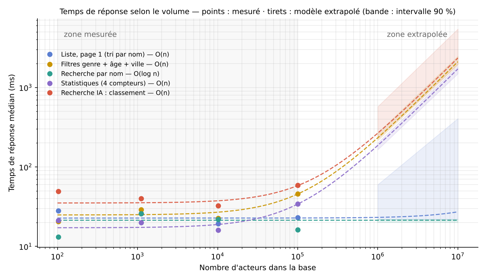
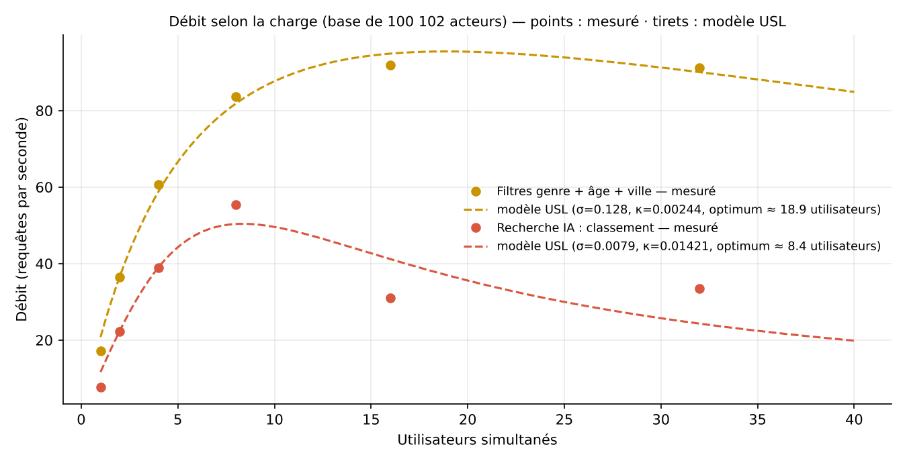

# Performance : temps de réponse et volume de données

> Décision du client **D-004** : toute courbe « temps de réponse / volume » repose sur une **mise à l'échelle théorique**,
> pas sur une mesure isolée. Mesures du 16/11/2026 sur le PC de développement
> (Intel i5-11400H, 24 Go, RTX 3050 Ti 4 Go, PostgreSQL 16 dans Docker). Coût : 0 €.

## Résumé

- **Jusqu'à 100 000 acteurs (mesuré)**, toutes les pages répondent en **moins de 60 ms** ; l'explication par l'IA reste à **7–10 s** quel que soit le volume.
- **À 1 million d'acteurs (extrapolé)**, les filtres, les statistiques et le classement IA passent à **≈ 0,2–0,3 s** : encore confortable.
- **À 10 millions (extrapolé)**, ces trois étapes atteignent **≈ 2 s** : il faudra des compteurs pré-calculés et un filtrage plus sélectif avant ce seuil.
- **Charge simultanée** : le serveur sature vers **19 utilisateurs** pour les filtres (≈ 95 requêtes/s) et vers **8 utilisateurs** pour le classement IA (≈ 50 requêtes/s), qui se dégrade au-delà.

## Méthode

1. **Mesurer à 4 volumes** : 102, 1 102, 10 102 et 100 102 acteurs (acteurs fictifs avec 2 langues, 2 compétences et 4 photos chacun,
   ajoutés puis retirés par `infra/perf/scale-bench.ps1`). 7 appels par étape et par volume, après un appel d'échauffement ;
   on garde la médiane.
2. **Attribuer à chaque étape sa complexité théorique**, d'après ce qu'elle fait réellement en base (tableau ci-dessous).
3. **Ajuster le modèle** `t(n) = a + b·f(n)` par moindres carrés à coefficients positifs (le temps ne peut pas baisser quand le volume monte).
4. **Estimer la marge** : 2 000 rééchantillonnages des mesures (bootstrap), intervalle à 90 %.
5. **Charge simultanée** : débit mesuré pour 1 à 32 utilisateurs, modèle **Universal Scalability Law** (Gunther) :
   `X(N) = λN / (1 + σ(N−1) + κN(N−1))`, où σ mesure la contention (attente d'une ressource partagée) et κ le coût de cohérence.
6. **Toujours distinguer mesuré et extrapolé** : points pleins = mesuré ; tirets et bandes = modèle.

Reproduire : `powershell -File infra\perf\scale-bench.ps1` puis `python infra/perf/model.py`.

## Résultats par étape

| Étape | Complexité | Pourquoi | Mesuré 10 102 | Mesuré 100 102 | Extrapolé 1 M | Extrapolé 10 M |
|---|---|---|---|---|---|---|
| Liste, page 1 | O(n) | index sur le nom + `LIMIT`, mais le total de la page (`count`) parcourt la table | 19 ms | 23 ms | 23 ms (22–60) | 27 ms (22–407) |
| Filtres genre + âge + ville | O(n) | `count` et filtrage sur une part de la table proportionnelle à n | 23 ms | 46 ms | **233 ms** (216–269) | **2,1 s** (1,9–2,5) |
| Recherche par nom | O(log n) | index trigramme `pg_trgm` | 22 ms | 16 ms | 21 ms (20–22) | 21 ms (20–22) |
| Statistiques (4 compteurs) | O(n) | `count(*)` sur 4 tables | 16 ms | 34 ms | **187 ms** (165–201) | **1,7 s** (1,5–1,9) |
| Recherche IA : classement | O(n) | score calculé en base sur chaque candidat, puis tri | 32 ms | 59 ms | **266 ms** (227–575) | **2,3 s** (2,0–5,4) |
| Recherche IA : explication | O(1) | le modèle ne lit que le top 5 | 7,0 s | 10,0 s | 7,9 s (7,3–10,0) | 7,9 s (7,3–10,0) |

Entre parenthèses : intervalle à 90 %. Pente mesurée des étapes en O(n) : **0,17 à 0,23 ms par tranche de 1 000 acteurs**.
Pour la liste, la pente n'est pas mesurable jusqu'à 100 000 acteurs (le `count` reste sous la milliseconde à ce volume), d'où la marge large à 10 M.

## Charge simultanée (base de 100 102 acteurs)

| Étape | λ (req/s pour 1 utilisateur) | σ contention | κ cohérence | Optimum | Débit max |
|---|---|---|---|---|---|
| Filtres genre + âge + ville | 20,8 | 0,128 | 0,0024 | ≈ 19 utilisateurs | ≈ 95 req/s |
| Recherche IA : classement | 11,7 | 0,008 | 0,0142 | ≈ 8 utilisateurs | ≈ 50 req/s |

Lecture : au-delà de l'optimum, ajouter des utilisateurs **fait baisser** le débit total (chacun attend plus longtemps).
Le κ élevé du classement IA pointe vers une ressource partagée saturée : le pool de connexions à la base (10 par défaut)
et le processeur, sollicités par le calcul du score sur chaque candidat.

## Limites de la mesure

- Les volumes 102 et 1 102 ont été mesurés juste après le démarrage du serveur Java : temps légèrement gonflés par le « préchauffage »
  de la JVM. Ils sont affichés mais **exclus de l'ajustement** du modèle.
- Le test à 1 utilisateur inclut l'ouverture de la première connexion du client de test.
- Les acteurs fictifs sont réguliers (8 villes, 5 couleurs de cheveux) : de vraies données peuvent être plus ou moins sélectives.
- L'extrapolation à 10 M suppose que la base tient en mémoire ; au-delà de la RAM disponible, les temps augmenteraient plus vite.

## Actions recommandées (gratuites)

| Priorité | Action | Effet attendu |
|---|---|---|
| Avant 1 M d'acteurs | Statistiques pré-calculées (vue matérialisée rafraîchie périodiquement) | Statistiques en O(1) |
| Avant 1 M | Total approximatif (`pg_class.reltuples`) ou pagination par curseur au lieu du `count` exact | Liste et filtres sans parcours complet |
| Avant 1 M | Index composite (genre, date de naissance, ville) et filtrage avant le calcul du score IA | Classement IA proche de O(log n) |
| Charge > 8 utilisateurs | Pool de connexions ajusté (HikariCP) et cache court des recherches identiques | Optimum USL repoussé |
| Phase 2 | Pré-sélection par similarité vectorielle (pgvector, déjà installé) avant le classement | Classement en temps quasi constant |
