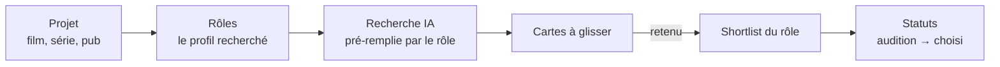
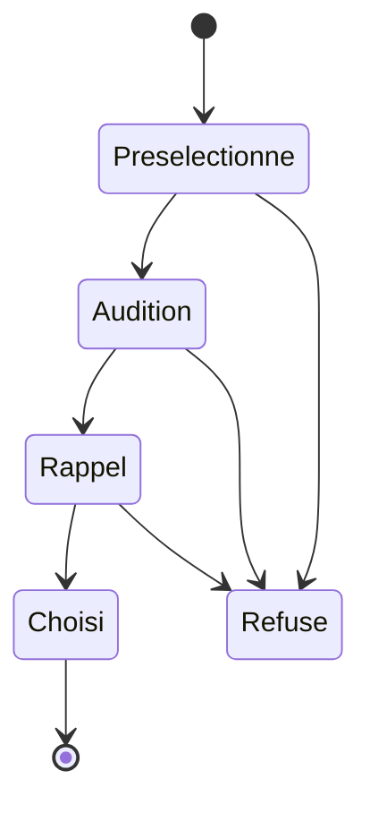
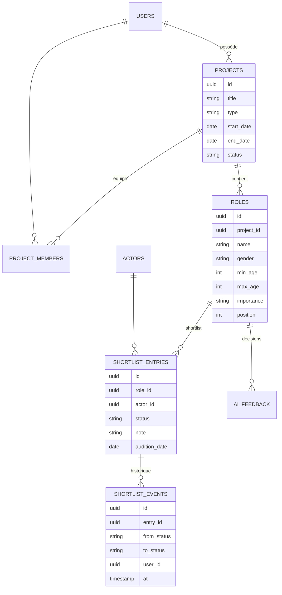

# User stories du MVP — Projets, rôles, shortlists

> Décision du client **D-002** (16/11/2026) : le MVP couvre les projets, les rôles et les shortlists.
> Le portail acteur et l'abonnement sont prévus en phase 3.
> Phase 1, semaines S3 à S6. Rédaction : Produit & UX ; relecture : Backend, Frontend, QA.

## Pourquoi ce MVP

Aujourd'hui, l'application trouve des acteurs (recherche IA, cartes à glisser), mais rien ne relie ces choix
à un **travail réel**. Un directeur de casting travaille toujours *pour un projet* (film, série, publicité) et
*pour un rôle précis* (« Léa, 30 ans, avocate bilingue »). Le MVP ajoute ce fil conducteur :

## Personas

| Persona | Rôle dans l'appli (`Role`) | Besoin principal |
|---|---|---|
| **Claire**, directrice de casting | `CASTING_DIRECTOR` | Organiser ses projets, trouver vite les bons profils, suivre les auditions |
| **Yanis**, assistant casting | `USER` | Préparer les shortlists, mettre à jour les statuts |
| **Admin** de l'agence | `ADMIN` | Gérer les comptes ; voir tous les projets |

## Vue d'ensemble

| Épopée | Stories | Priorité | Estimation |
|---|---|---|---|
| E1 · Projets | US-01 à US-04 | P0 | 5 j |
| E2 · Rôles | US-05 à US-08 | P0 | 5 j |
| E3 · Shortlists | US-09 à US-14 | P0 | 8 j |
| E4 · Suivi et partage | US-15 à US-17 | P1 | 4 j |
| **Total** | **17 stories** | | **≈ 22 jours-personne** |

Estimations en jours-personne (backend + frontend + tests), à affiner au planning de sprint.

---

## E1 · Projets

### US-01 · Créer un projet — P0
**En tant que** directrice de casting, **je veux** créer un projet (titre, type, dates, description)
**afin de** regrouper tout le travail d'une production.

Critères d'acceptation :
- Le titre est obligatoire ; le type est choisi parmi : long métrage, série, court métrage, publicité, théâtre, autre.
- Les dates de début et de fin sont facultatives ; la fin ne peut pas précéder le début (message clair).
- Après création, j'arrive sur la page du projet, vide, avec une invitation à ajouter un premier rôle.
- Le créateur devient propriétaire du projet.

### US-02 · Voir mes projets — P0
**En tant que** directrice de casting, **je veux** une liste de mes projets avec leur avancement
**afin de** savoir où j'en suis d'un coup d'œil.

Critères d'acceptation :
- Chaque projet affiche : titre, type, dates, nombre de rôles, nombre de rôles pourvus (« 3 / 5 rôles pourvus »).
- Filtres : en cours, terminés, archivés ; tri par date de mise à jour.
- Nouvelle entrée « Projets » dans le menu, au-dessus de « Acteurs ».

### US-03 · Modifier ou archiver un projet — P0
Critères d'acceptation :
- Tous les champs de US-01 sont modifiables.
- « Archiver » retire le projet de la liste « en cours » sans rien supprimer ; « Restaurer » le fait revenir.
- La suppression définitive est réservée à l'`ADMIN` et demande une confirmation.

### US-04 · Équipe du projet — P1
**En tant que** directrice de casting, **je veux** ajouter des collègues à un projet
**afin qu'**ils préparent les shortlists avec moi.
- Seuls les membres (et l'`ADMIN`) voient le projet. Un `USER` ne peut ni supprimer ni archiver le projet.

---

## E2 · Rôles

### US-05 · Créer un rôle — P0
**En tant que** directrice de casting, **je veux** décrire un rôle dans un projet
**afin de** chercher les acteurs qui lui correspondent.

Critères d'acceptation :
- Champs : nom du rôle (obligatoire), description libre, genre, âge min et max, langues, compétences, ville, dates de tournage.
- Importance : principal, secondaire, figuration.
- L'âge min ne peut pas dépasser l'âge max.

### US-06 · Chercher des acteurs pour un rôle — P0
**En tant que** directrice de casting, **je veux** lancer la recherche IA depuis un rôle
**afin de** ne pas retaper les critères.

Critères d'acceptation :
- Le bouton « Trouver des acteurs » ouvre la recherche IA avec une phrase pré-remplie à partir du rôle
  (ex. « femme entre 25 et 35 ans parlant anglais, danse ») ; je peux la modifier avant d'envoyer.
- Les cartes indiquent en haut le rôle concerné : « Pour : Léa · Projet Les Passagers ».
- Les acteurs déjà dans la shortlist du rôle n'apparaissent pas une seconde fois.

### US-07 · Disponibilités — P1
- Si le rôle a des dates de tournage, une carte affiche « Indisponible du … au … » quand l'acteur a une
  indisponibilité qui chevauche (données `ActorAvailability` déjà présentes).

### US-08 · Modifier, réordonner, supprimer un rôle — P0
- Les rôles d'un projet se réordonnent par glisser-déposer.
- Supprimer un rôle qui a une shortlist demande une confirmation et indique le nombre d'acteurs concernés.

---

## E3 · Shortlists

### US-09 · Glisser à droite = ajouter à la shortlist — P0
**En tant que** directrice de casting, **quand je retiens** une carte pendant une recherche lancée depuis un rôle,
**je veux** que l'acteur entre dans la shortlist de ce rôle **afin de** ne rien recopier.

Critères d'acceptation :
- Glisser à droite (ou ✓, ou →) ajoute l'acteur à la shortlist avec le statut « Présélectionné ».
- Annuler (↺) le retire de la shortlist.
- La décision est toujours enregistrée dans `ai_feedback` (signal pour l'IA fédérée), désormais avec le rôle.
- Sans rôle sélectionné, le comportement actuel est conservé (décision enregistrée, pas de shortlist).

### US-10 · Ajouter à une shortlist depuis une fiche ou le fichier d'acteurs — P0
- Bouton « Ajouter à un rôle » sur la fiche acteur et au survol d'une vignette du tableau de bord.
- Je choisis le projet puis le rôle ; un acteur ne peut être qu'une fois dans la même shortlist (message clair).

### US-11 · Voir la shortlist d'un rôle — P0
Critères d'acceptation :
- Planche contact des acteurs : photo, nom, âge, ville, statut, note.
- Compteurs par statut en haut : « 8 présélectionnés · 3 en audition · 1 choisi ».

### US-12 · Faire avancer un acteur dans le processus — P0
**En tant que** directrice de casting, **je veux** changer le statut d'un acteur
**afin de** suivre où en est chaque candidat.

Statuts, dans l'ordre :

Critères d'acceptation :
- Vue en colonnes (une par statut) avec glisser-déposer, et vue liste.
- Un seul acteur peut être « Choisi » par rôle ; en choisir un second demande de confirmer le remplacement.
- Quand un acteur est « Choisi », le rôle passe à « Pourvu » et le compteur du projet se met à jour (US-02).
- Chaque changement est horodaté avec son auteur.

### US-13 · Annoter un candidat — P1
- Note libre et date d'audition par acteur dans la shortlist ; visibles par l'équipe du projet.

### US-14 · Retirer un acteur de la shortlist — P0
- Retirer ne supprime pas l'acteur du fichier ; une annulation est proposée pendant 5 secondes.

---

## E4 · Suivi et partage

### US-15 · Tableau de bord par projet — P1
- Pour chaque rôle : statut (à pourvoir / pourvu), nombre de candidats par statut, dernière activité.

### US-16 · Exporter une shortlist — P1
- Export PDF « planche contact » (photo, nom, âge, ville, note) pour l'envoyer à la production.
- Généré localement, sans service payant.

### US-17 · Journal d'activité — P1
- Qui a ajouté, retiré, fait avancer quel acteur, et quand ; filtrable par rôle.

---

## Modèle de données (proposition)

- Migrations prévues : `V9__create_projects.sql`, `V10__create_roles.sql`, `V11__create_shortlists.sql`,
  et une colonne `role_id` (facultative) ajoutée à `ai_feedback`.
- Contrainte d'unicité (`role_id`, `actor_id`) sur `shortlist_entries` ; un seul statut `CHOISI` par rôle (index partiel).

## API (proposition)

| Méthode et chemin | Rôle | Stories |
|---|---|---|
| `GET` / `POST /api/projects` | Lister, créer | US-01, US-02 |
| `GET` / `PUT` / `DELETE /api/projects/{id}` · `POST …/archive` | Lire, modifier, archiver | US-03 |
| `GET` / `POST /api/projects/{id}/members` | Équipe | US-04 |
| `GET` / `POST /api/projects/{id}/roles` · `PUT` / `DELETE /api/roles/{id}` · `PUT …/order` | Rôles | US-05, US-08 |
| `GET /api/roles/{id}/search-prompt` | Phrase de recherche pré-remplie | US-06 |
| `GET` / `POST /api/roles/{id}/shortlist` · `PATCH` / `DELETE /api/shortlist/{entryId}` | Shortlist, statuts, notes | US-09 à US-14 |
| `GET /api/roles/{id}/shortlist/export.pdf` | Export | US-16 |
| `POST /api/ai/feedback` (+ `roleId` facultatif) | Décision de carte, reliée au rôle | US-09 |

## Écrans

1. **Projets** (nouvelle entrée de menu) : grille des projets avec leur avancement.
2. **Projet** : en-tête (titre, dates, équipe) puis la liste des rôles avec leur état.
3. **Rôle** : critères à gauche ; shortlist à droite, en colonnes par statut ; bouton « Trouver des acteurs ».
4. **Recherche IA** : bandeau « Pour : rôle · projet » au-dessus des cartes.

## Hors périmètre du MVP

Portail acteur, abonnement et paiement, messagerie avec les agents, planning d'auditions avec calendrier externe,
application mobile. Tout reste gratuit et local (règle du client).

## Définition de « terminé »

- Critères d'acceptation vérifiés dans le navigateur par la QA.
- Tests d'intégration (Testcontainers) pour chaque nouveau point d'API, y compris les refus (401, 403, 404, 409).
- Migrations Flyway rejouables sur une base vide.
- README et salle de pilotage mis à jour ; aucun commit ni push sans l'accord du client.

## Découpage proposé

| Sprint | Contenu | Livrable visible |
|---|---|---|
| S3 | E1 (US-01 à US-03) + modèle de données et migrations | Créer et lister ses projets |
| S4 | E2 (US-05, US-06, US-08) | Rôles et recherche pré-remplie |
| S5 | E3 (US-09 à US-12, US-14) | Glisser à droite remplit la shortlist ; suivi des statuts |
| S6 | P1 : US-04, US-07, US-13, US-15 à US-17 + recette | Équipe, export PDF, journal ; démo client |
